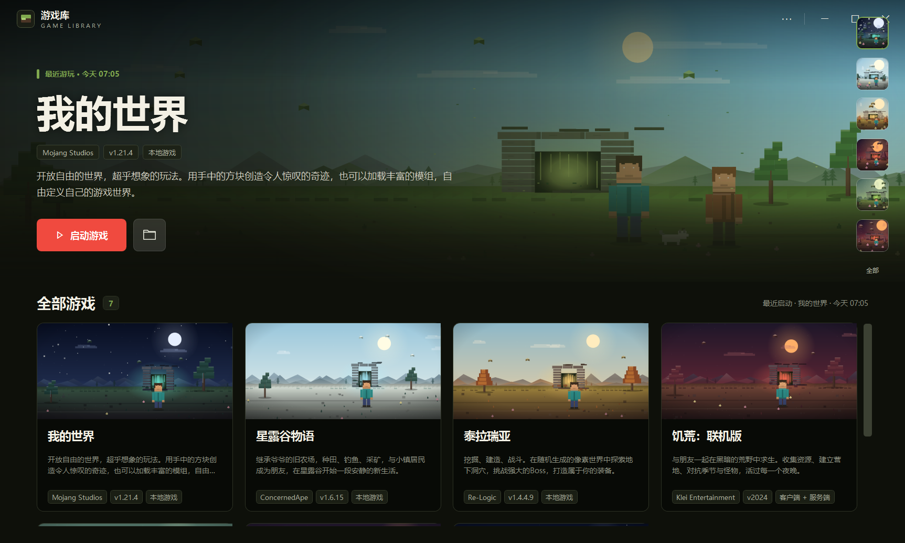
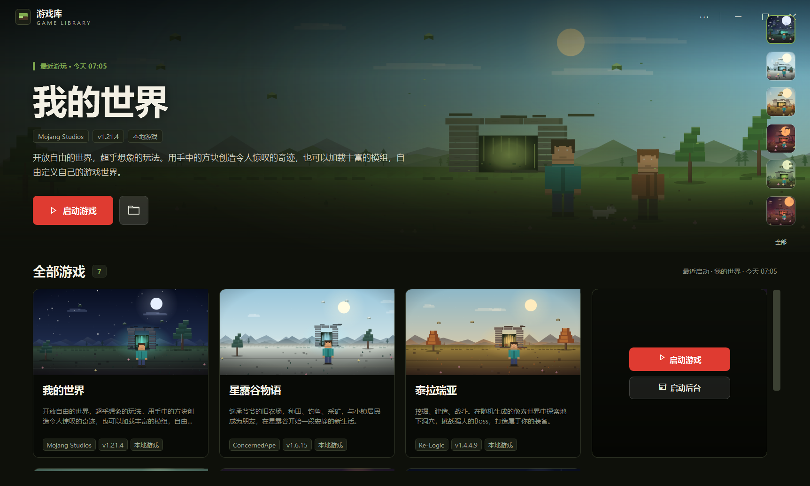
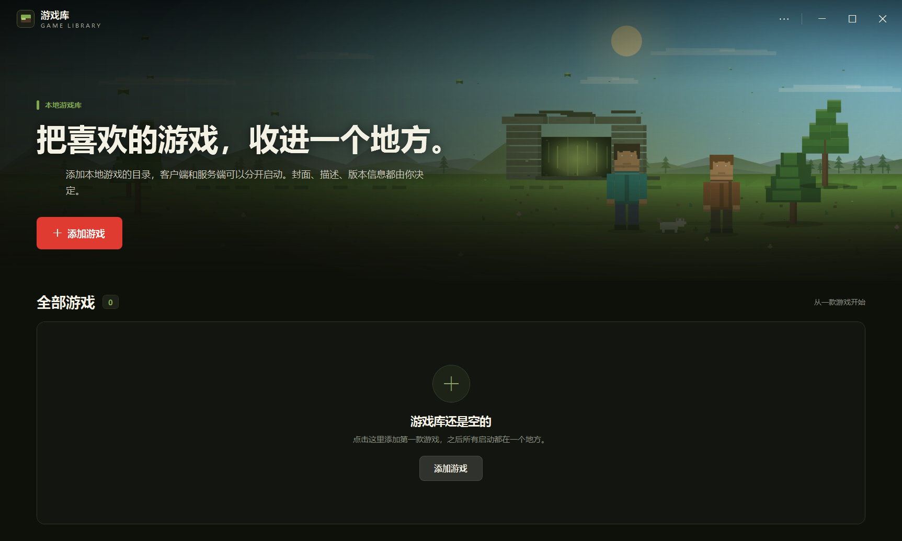
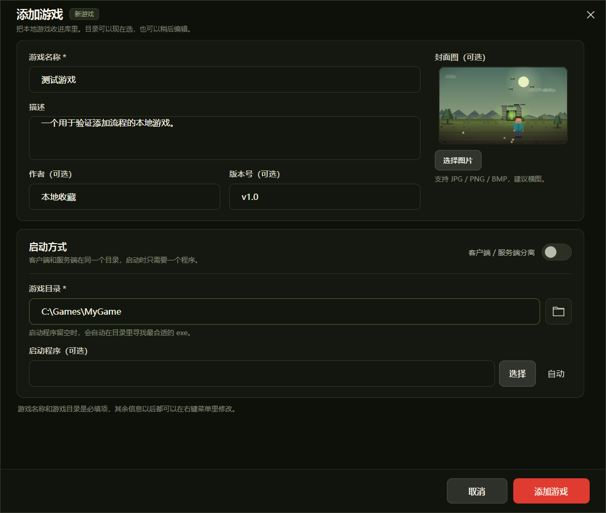
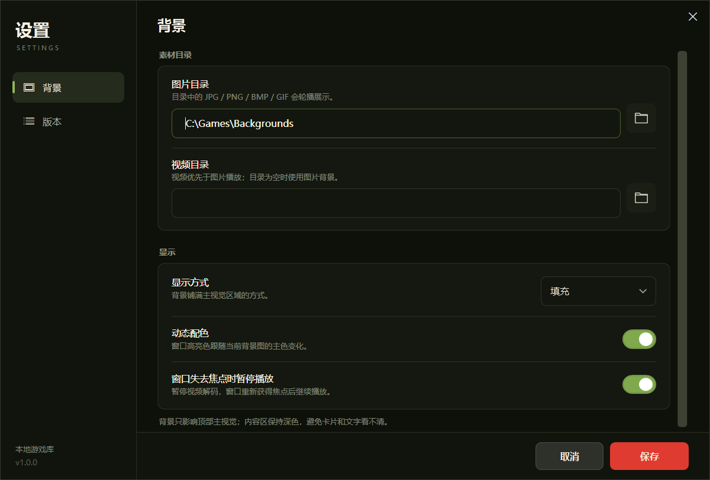
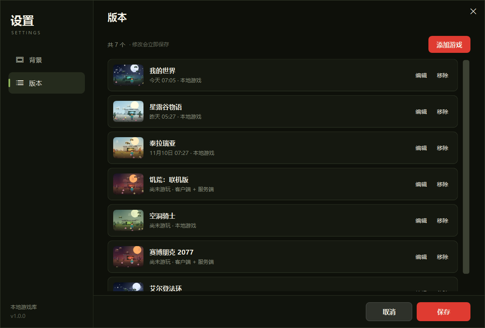
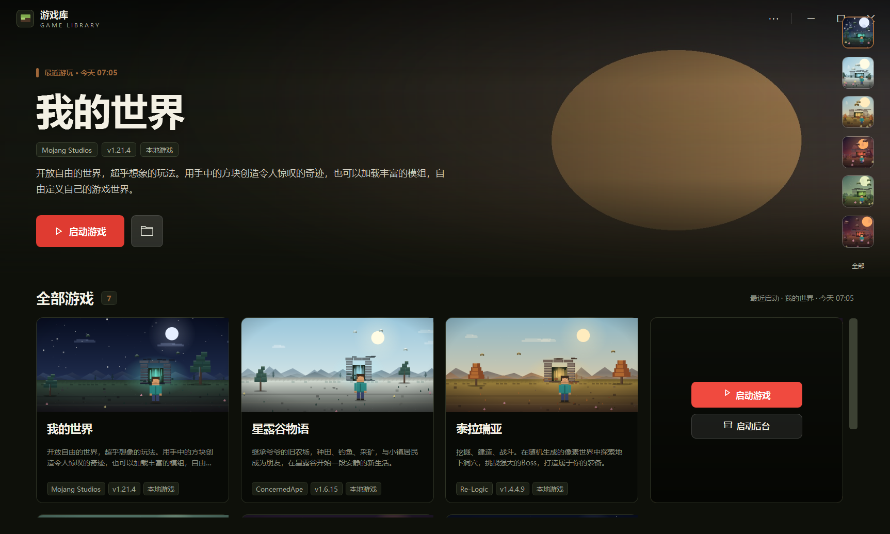

# 游戏库

一个 Windows 本地游戏收藏夹。把散落在硬盘里的游戏收进一个界面，记录最近游玩，一键启动客户端或后台服务。

主界面参考了深色游戏库的视觉结构。默认封面是程序化绘制的像素场景，没有设置封面的游戏会按游戏名稳定分配；主视觉也使用程序化场景。



## 功能

- **主版游戏**：自动选择最近游玩的游戏；从未游玩过时，选择最早添加的那一个。
- **游戏库网格**：置顶游戏优先，其余按添加顺序展示；封面、名称、描述、作者/版本/类型标签一应俱全。
- **悬停启动**：鼠标移到卡片上，整张卡片覆盖半透明遮罩并轻微模糊，启动按钮居中显示；客户端/服务端分离的游戏会多一个「启动后台」。下方信息仍然可见。
- **置顶**：卡片右键菜单第一项「置顶」，置顶后移到列表最前面；继续置顶其他游戏时，最新置顶排第一，之前的置顶依次顺延，不会互相取消。
- **客户端 / 服务端分离**：添加时可选择是否分离，分别指定客户端目录和服务端目录，各自启动。
- **自动寻找启动程序**：目录里留空时，会在两层目录内寻找最合适的 `.exe` / `.bat` / `.cmd` / `.lnk`，跳过卸载器、运行库等。
- **背景设置**：支持图片目录轮播和视频背景；显示方式可选填充、适应、拉伸、平铺；可根据图片自动提取窗口主色；窗口失焦时可暂停视频。
- **版本管理**：设置里的「版本」页可以编辑、移除、继续添加游戏。
- **右键菜单**：置顶、启动游戏、启动后台、编辑、打开目录、移除。
- **本地存储**：所有数据都在一个 JSON 文件里，封面复制到 `covers`，不依赖数据库或网络。



## 下载

到 [Releases](https://github.com/shixianzhou/game-library/releases) 下载最新版本，三个包按需选择：

| 文件 | 说明 |
| --- | --- |
| `GameLibrary-<版本>-win-x64-self-contained.zip` | **无依赖版**：自带 .NET 运行时，解压即用，不需要安装任何东西，体积较大 |
| `GameLibrary-<版本>-win-x64-framework-dependent.zip` | **依赖版**：体积小，需要先安装 [.NET 10 Desktop Runtime](https://dotnet.microsoft.com/download/dotnet/10.0) |
| `GameLibrary-<版本>-source.zip` | **源码包**：不含编译产物，用 .NET 10 SDK 自行构建 |

推送 `v*` 标签（如 `git tag v1.0.1 && git push origin v1.0.1`）会触发 GitHub Actions 自动构建这三个包并创建 Release；也可以在 Actions 页面手动运行，只生成可下载的构建产物。

## 运行

直接运行 `游戏库.exe`。无依赖版是自包含的 Windows x64 单文件程序，不需要另装 .NET；依赖版需要 .NET 10 Desktop Runtime。

程序默认以管理员权限启动，Windows 会弹出 UAC 确认框；这是为了启动某些需要管理员权限的游戏或后台服务。框架依赖版同样使用这个 manifest，需要先安装 .NET 10 Desktop Runtime。

第一次打开是空库，点击主版上的「添加游戏」，或按 `Ctrl+N` / 右上角菜单「添加游戏」。



### 添加游戏

必填项只有**游戏名称**和**游戏目录**。启动程序可以留空，让程序自动寻找；也可以手动指定。

如果这个游戏需要先开后台、再开客户端，打开「客户端 / 服务端分离」，分别选择两个目录即可。



### 快捷键

| 快捷键 | 作用 |
| --- | --- |
| `F5` | 启动当前主版游戏 |
| `Ctrl+N` | 添加游戏 |
| `Ctrl+,` | 打开设置 |
| `Esc` | 关闭当前弹窗 |
| `Ctrl+S` | 在设置里保存 |

## 设置



- **图片目录**：目录内的 `JPG / PNG / BMP / GIF` 会轮播展示，12 秒换一张。
- **视频目录**：目录内存在可播放视频时优先播放视频；目录为空时回到图片。
- **显示方式**：填充、适应、拉伸、平铺。
- **动态配色**：从当前背景图提取主色，应用到标题前的竖条、标签边框、右侧选中框等位置。
- **窗口失去焦点时暂停播放**：避免在后台继续解码视频。

「版本」页就是游戏列表，可以在这里编辑、移除或添加游戏，改动会立即保存。



## 数据存放

默认放在 `游戏库.exe` 同目录：

```
游戏库.exe
library.json      # 游戏库数据
covers\           # 添加时复制进来的封面
```

如果 exe 所在目录不可写（例如装在 `Program Files`），会自动改用：

```
%LocalAppData%\PixelGameLibrary\
```

也可以设置环境变量 `GAME_LIBRARY_HOME` 指定数据目录，方便做便携版或测试。

## 背景示例

把图片目录指向自己的素材文件夹即可。下图使用测试图片验证了填充、暗渐变和动态主色：



## 从源码构建

需要 .NET 10 SDK（Windows）。

```powershell
dotnet build .\GameLibrary.csproj -c Release
dotnet run --project .\GameLibrary.csproj
```

一键生成三个发布包（无依赖版、依赖版、源码包）：

```powershell
pwsh -File .\scripts\build-release.ps1
```

产物在 `release\` 目录下。也可以只发布自包含单文件：

```powershell
dotnet publish .\GameLibrary.csproj -c Release -r win-x64 --self-contained true `
  -p:PublishSingleFile=true `
  -p:IncludeNativeLibrariesForSelfExtract=true `
  -p:EnableCompressionInSingleFile=true `
  -o .\dist
```

## 说明

- 程序没有代码签名，首次运行时 Windows SmartScreen 可能提示“已保护你的电脑”；选择“更多信息 → 仍要运行”即可。
- 程序 manifest 为 `requireAdministrator`，启动时会请求管理员权限，同意 UAC 即可。若不需要管理员，可使用框架依赖版或自行修改 `app.manifest` 后重新构建。
- 启动 `.bat` / `.cmd` 时 Windows 仍可能弹出「打开文件 - 安全警告」，点「运行」即可。
- 视频背景依赖系统已安装的解码器；如果视频无法播放，会自动回退到图片或程序化背景。
- 封面支持 `JPG / PNG / BMP / GIF`，建议使用横图。
- 主版游戏始终按「最近游玩 → 最早添加」决定；在右侧快捷栏点选只是临时预览，不会改变游玩记录。
